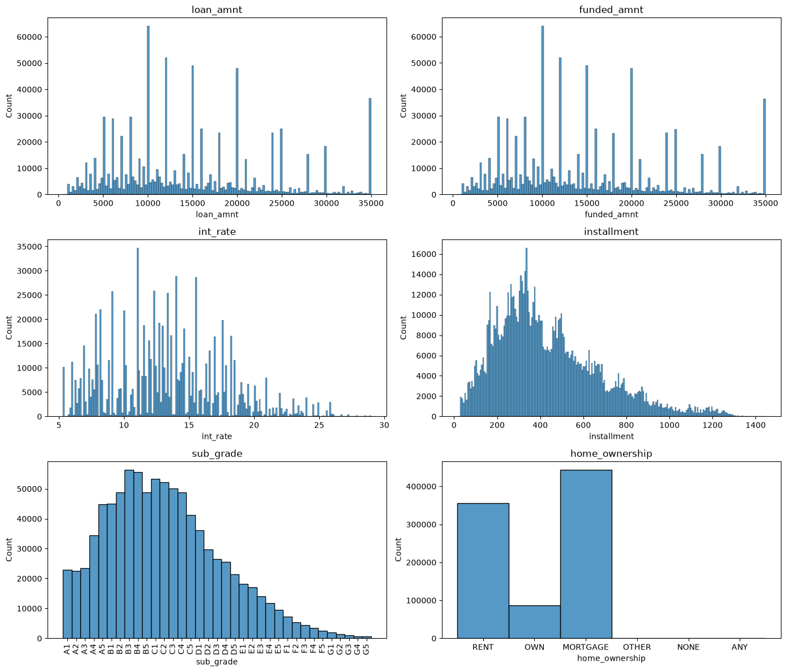
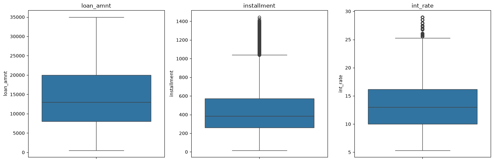
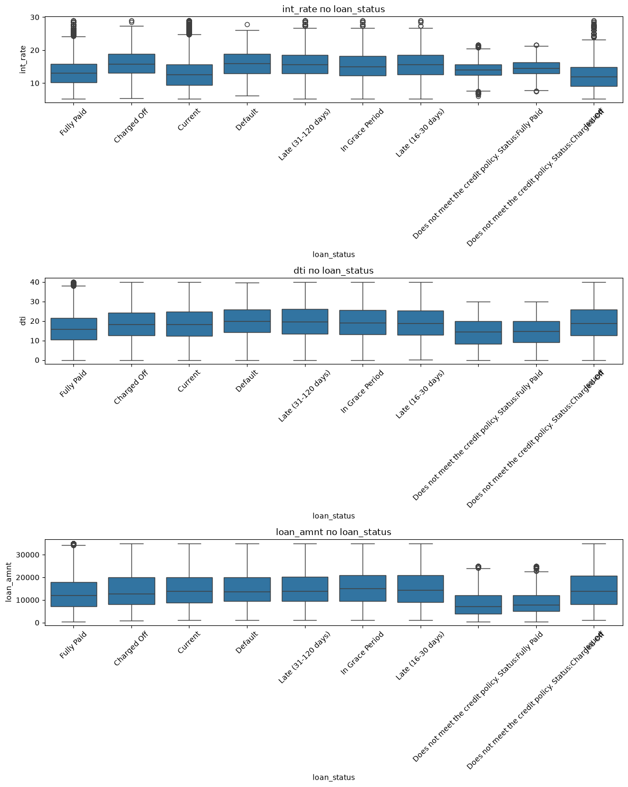
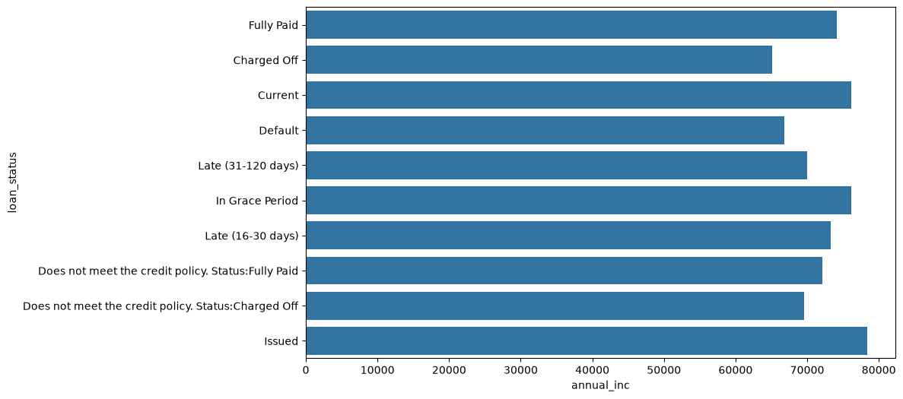
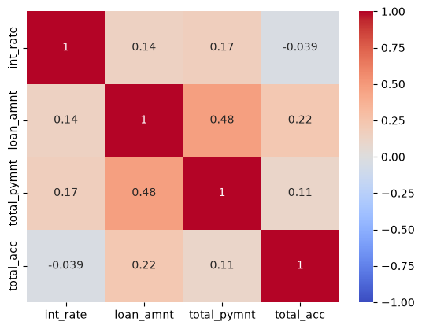
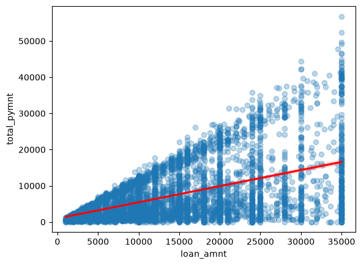

<div align="center">

# 📊 Credit Risk Analysis

**Разведочный анализ кредитного портфеля: качество данных, распределения, риски заёмщиков**


</div>

---

## 📌 О проекте

Учебная практика по анализу данных. Задача поставлена от лица аналитика кредитного продукта: из хранилища выгружена таблица выданных кредитов с платёжной дисциплиной заёмщиков, и нужно **оценить кредитные риски, найти аномалии в данных и сформулировать рекомендации** для улучшения работы банка с клиентами.

Данные — публичный датасет [Credit Risk Dataset (Kaggle)](https://www.kaggle.com/datasets/ranadeep/credit-risk-dataset/data): **887 379 кредитов, 74 поля**.

📓 Основной файл: [`Practic.ipynb`](Practic.ipynb) · 🌐 Версия для просмотра без Jupyter: [`Practic.html`](Practic.html)

## 🧭 Содержание

- [Что нужно было сделать](#-что-нужно-было-сделать)
- [Как я это делал](#-как-я-это-делал)
  - [1. Подготовка данных](#1-подготовка-данных)
  - [2. Распределения](#2-распределения)
  - [3. Риск в разрезе статуса займа](#3-риск-в-разрезе-статуса-займа)
  - [4. Корреляции](#4-корреляции)
- [Ключевые выводы](#-ключевые-выводы)
- [Как запустить](#-как-запустить)
- [Структура репозитория](#-структура-репозитория)

---

## 🎯 Что нужно было сделать

Задание состояло из четырёх блоков.

| Блок | Шаги |
|---|---|
| **Подготовка данных** | загрузить CSV в `DataFrame`; найти доли групп заявок (`application_type`) и пропуски по группам; удалить группы с долей < 5%; удалить поля с > 20% пропусков; проверить дубликаты; посчитать частоты значений в `grade`, `home_ownership`, `verification_status`, `pymnt_plan`; удалить поля с малым числом значений и сильным смещением (> 80% одного значения) |
| **Распределения** | гистограммы для `loan_amnt`, `funded_amnt`, `int_rate`, `installment`, `sub_grade`, `home_ownership`; полная статистика по `loan_amnt` (min/max, среднее, медиана, std, квантили 1/5/95/99%) с выводом; boxplot для `loan_amnt`, `installment`, `int_rate` и оценка выбросов |
| **Риск по статусу займа** | boxplot для `int_rate`, `dti`, `loan_amnt` по `loan_status`; barplot среднего `annual_inc` по `loan_status`; выводы о тенденциях |
| **Корреляции** | корреляционная матрица для `int_rate`, `loan_amnt`, `total_pymnt`, `total_acc`; найти пару с максимальной корреляцией и построить график их связи |

## 🔬 Как я это делал

### 1. Подготовка данных

Данные загружены в `pandas` и последовательно очищены. Каждый шаг в ноутбуке сопровождается кодом, результатом и письменным выводом.

| Шаг | Что сделал | Результат |
|---|---|---|
| Доли групп заявок | `value_counts(normalize=True)` по `application_type` | `INDIVIDUAL` — 99,94%, `JOINT` — 0,06% |
| Малые группы | удалил группы с долей < 5% | убрана `JOINT` (511 записей), осталось **886 868** строк |
| Пропуски | удалил поля с долей пустых значений > 20% | убрано **22 поля** (`desc`, `annual_inc_joint`, `dti_joint`, `open_il_*`, `inq_last_12m`, `all_util` и др.), осталось 52 |
| Дубликаты | полные дубли строк + дубли по каждому полю | полных дублей **нет**; `id`, `member_id`, `url` уникальны |
| Смещённые поля | удалил поля с < 10 уникальных значений и долей одного значения > 80% | убраны `pymnt_plan`, `policy_code`, `application_type`, `acc_now_delinq` → **48 полей** |

```python
# фильтр групп по доле
keep = shares[shares >= 0.05].index
df = df[df['application_type'].isin(keep)].copy()

# фильтр полей по заполняемости
null_share = df.isna().mean()
df = df.drop(columns=null_share[null_share > 0.2].index)

# смещённые поля с малым числом значений
drop2 = [c for c in df.columns
         if df[c].nunique() < 10 and df[c].value_counts(normalize=True).iloc[0] > 0.8]
df = df.drop(columns=drop2)
```

### 2. Распределения



- Суммы займов (`loan_amnt` ≈ `funded_amnt`) имеют пики на «круглых» значениях — 10 000, 15 000, 20 000, 35 000; верхняя граница продукта — 35 000.
- `int_rate` и `installment` скошены вправо; основная масса ставок — 7–17%.
- Рейтинг `sub_grade` достигает пика на B3–B4 и плавно убывает к худшим категориям.
- Структура `home_ownership` — почти целиком `MORTGAGE` и `RENT` (~90%).

**Статистика по `loan_amnt`:**

| Min | Max | Среднее | Медиана | Std | 1% | 5% | 95% | 99% |
|---|---|---|---|---|---|---|---|---|
| 500 | 35 000 | 14 753 | 13 000 | 8 434 | 1 800 | 3 600 | 32 000 | 35 000 |

Среднее больше медианы — распределение скошено вправо; std составляет ~57% от среднего, выборка неоднородна. Квантиль 99% совпадает с максимумом, то есть выбросов сверх границы продукта нет.



У `loan_amnt` выбросов нет, у `installment` (выше ~1 040) и `int_rate` (выше ~25%) они есть, но объяснимы бизнес-логикой — крупные займы и рискованные заёмщики. Поэтому из выборки их **не удалял**.

### 3. Риск в разрезе статуса займа



- **`int_rate`**: у проблемных статусов (Charged Off, Default, Late) медиана ставки ≈ 15–16%, у Fully Paid ≈ 13%, у Current ≈ 12,5%. Банк закладывает более высокую ставку на более рискованных заёмщиков.
- **`dti`**: чем выше долговая нагрузка (медиана 16 у Fully Paid против 18–20 у проблемных), тем выше риск.
- **`loan_amnt`**: размер займа влияет на статус слабо.



Средний доход у Charged Off (~65 тыс.) и Default (~67 тыс.) заметно ниже, чем у Fully Paid (~74 тыс.) и Current (~76 тыс.): низкий доход снижает запас прочности заёмщика.

### 4. Корреляции

<p align="center">
  
  
</p>

Наибольшая корреляция — **`loan_amnt` ↔ `total_pymnt` (0,475)**: чем больше кредит, тем больше суммарные выплаты. Остальные связи слабые (0,11–0,22), а у `int_rate` и `total_acc` практически нулевая (−0,04). Разброс «веером» на графике объясняется займами, по которым платежи ещё не накопились (Current) или не поступали (Charged Off, Default).

## 💡 Ключевые выводы

- Данные пригодны для анализа: нет дублей, лишние и малоинформативные поля удалены.
- Рейтинг и процентная ставка отражают риск: у проблемных займов выше ставка и `dti`, ниже средний доход.
- Ни один показатель в отдельности не разделяет хорошие и плохие займы, поэтому для оценки риска нужно использовать **комплекс признаков** (ставка, `dti`, доход, рейтинг).
- **Рекомендация:** для заёмщиков с высокой долговой нагрузкой, низким доходом и рейтингами E–G стоит применять более консервативные лимиты.

## 🚀 Как запустить

```bash
git clone <ссылка-на-репозиторий>
cd <папка-репозитория>

python -m venv .venv
.venv\Scripts\activate          # Windows
# source .venv/bin/activate     # macOS / Linux

pip install -r requirements.txt
```

1. Скачайте датасет с [Kaggle](https://www.kaggle.com/datasets/ranadeep/credit-risk-dataset/data) и положите файл `loan.csv` в папку `data/`. Он весит около 400 МБ, поэтому в репозитории его нет.
2. Запустите Jupyter:

```bash
jupyter notebook
```

3. Откройте `Practic.ipynb` и выберите **Kernel → Restart Kernel and Run All Cells**. Полный прогон занимает около минуты.

## 🗂 Структура репозитория

```
.
├── Practic.ipynb        # основной ноутбук с кодом, результатами и выводами
├── Practic.html         # та же работа для просмотра без Jupyter
├── images/              # графики для README
├── data/                # сюда кладётся loan.csv (не хранится в git)
├── requirements.txt
└── README.md
```

## 🛠 Стек

`Python 3.12` · `pandas` · `NumPy` · `seaborn` · `Matplotlib` · `Jupyter`
